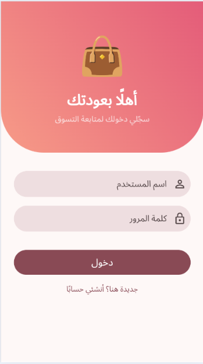
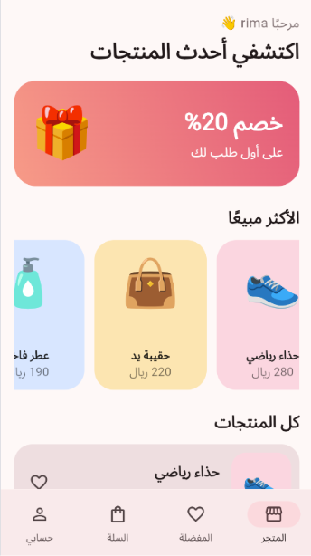
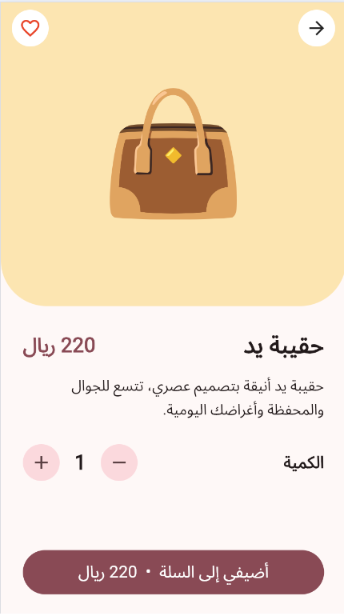
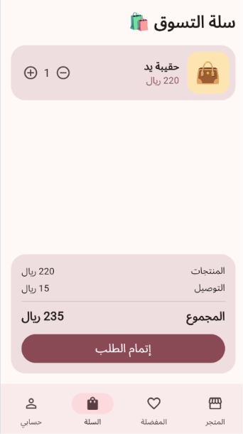

# ركن الأناقة | Style Corner

## بالعربية

**اسم التطبيق:** ركن الأناقة (Style Corner)
**اسم الطالبة:** ريما العمري

### فكرة التطبيق
متجر إلكتروني مصغّر للأزياء والإكسسوارات: تسجّل الطالبة دخولها، وتتصفح المنتجات، وتضيفها إلى السلة، وتؤكد الطلب.

### الشاشات
الافتتاحية، إنشاء حساب، تسجيل الدخول، المتجر، المفضلة، تفاصيل المنتج، السلة، حسابي، تم الطلب.

### شرح التطبيق والتنقل
- من الشاشة الافتتاحية ننتقل إلى تسجيل الدخول، ومنه إلى إنشاء حساب.
- الحسابات تُحفظ في `List` داخل التطبيق فقط (بدون قاعدة بيانات)، وتظهر رسالة خطأ عند: حقل فارغ، اسم مستخدم مسجّل مسبقًا، بيانات دخول غير صحيحة.
- بعد الدخول يظهر شريط سفلي فيه: المتجر، المفضلة، السلة، حسابي.
- عند الضغط على منتج ينتقل المنتج المختار إلى شاشة التفاصيل، ومنها يُضاف إلى السلة، وبعد إتمام الطلب تظهر شاشة تم الطلب.

### الميزة الإضافية
**المفضلة:** قلب على كل منتج لإضافته إلى المفضلة، وتبويب خاص يعرض المنتجات المفضلة.

### صور الشاشات
| تسجيل الدخول | المتجر |
|---|---|
|  |  |

| تفاصيل المنتج | السلة |
|---|---|
|  |  |

### فيديو التطبيق
[رابط الفيديو على Google Drive](https://drive.google.com/file/d/1XPOQvfZTwrCsV6MF2A-f2XjxWmYGtMaB/view?usp=sharing)

---

## English

**App name:** Style Corner
**Student name:** Rima Alamri

### App idea
A mini online store for fashion and accessories: the student logs in, browses the products, adds them to the cart, and confirms the order.

### Screens
Splash, Register, Login, Shop, Favorites, Product details, Cart, Account, Order done.

### How the app works
- From the splash screen we go to the login screen, and from it to the register screen.
- Accounts are stored in a `List` inside the app only (no database). An error message is shown for: an empty field, a username that is already registered, and wrong login data.
- After logging in, a bottom bar appears with: Shop, Favorites, Cart, Account.
- Tapping a product passes the selected product to the details screen, from there it is added to the cart, and after placing the order the Order done screen appears.

### Extra feature
**Favorites:** a heart on every product to add it to favorites, and a dedicated tab that shows the favorite products.

### Screenshots
| Login | Shop |
|---|---|
|  |  |

| Product details | Cart |
|---|---|
|  |  |

### Demo video
[Google Drive video link](https://drive.google.com/file/d/1XPOQvfZTwrCsV6MF2A-f2XjxWmYGtMaB/view?usp=sharing)
